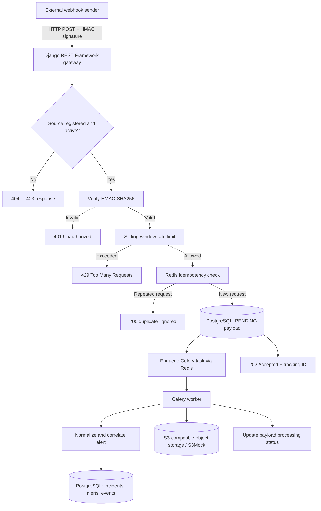
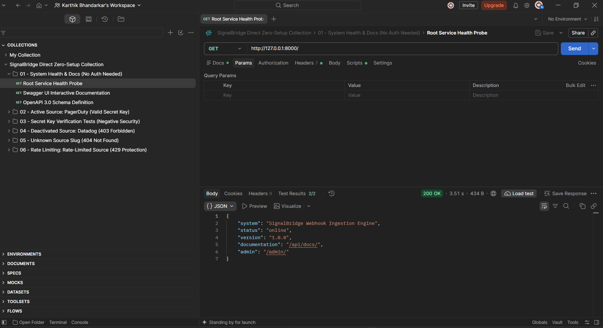
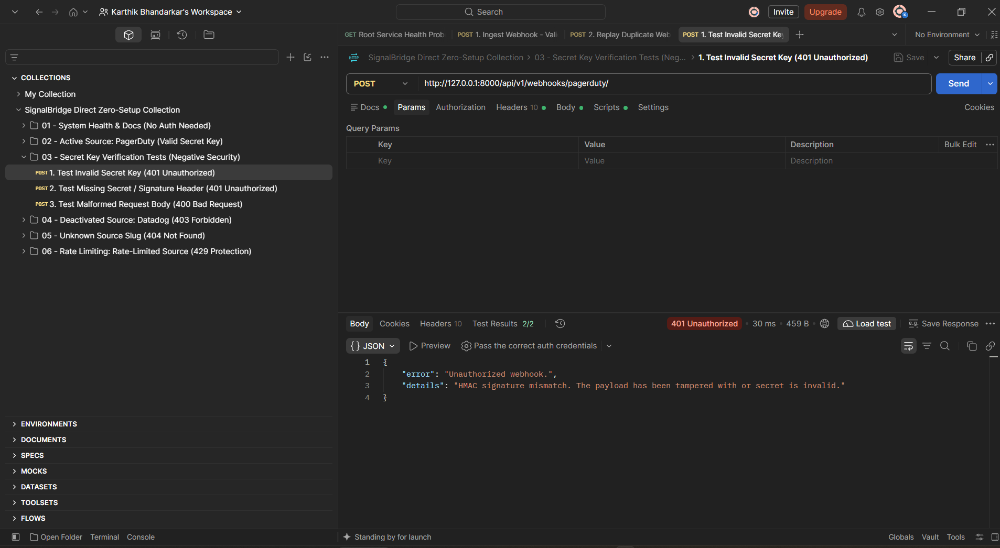
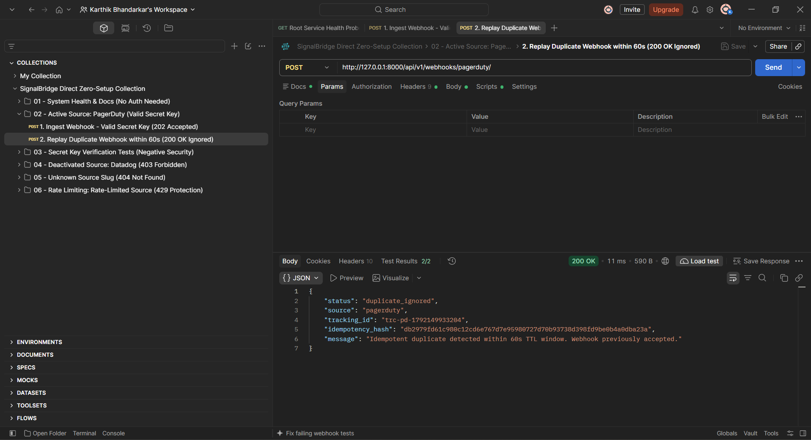
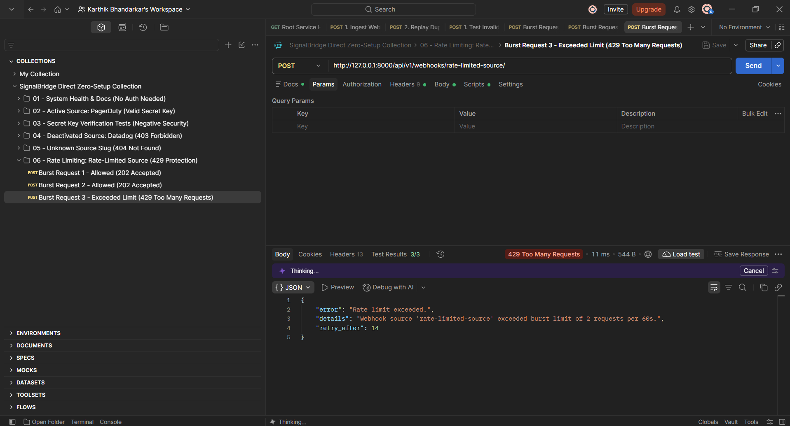
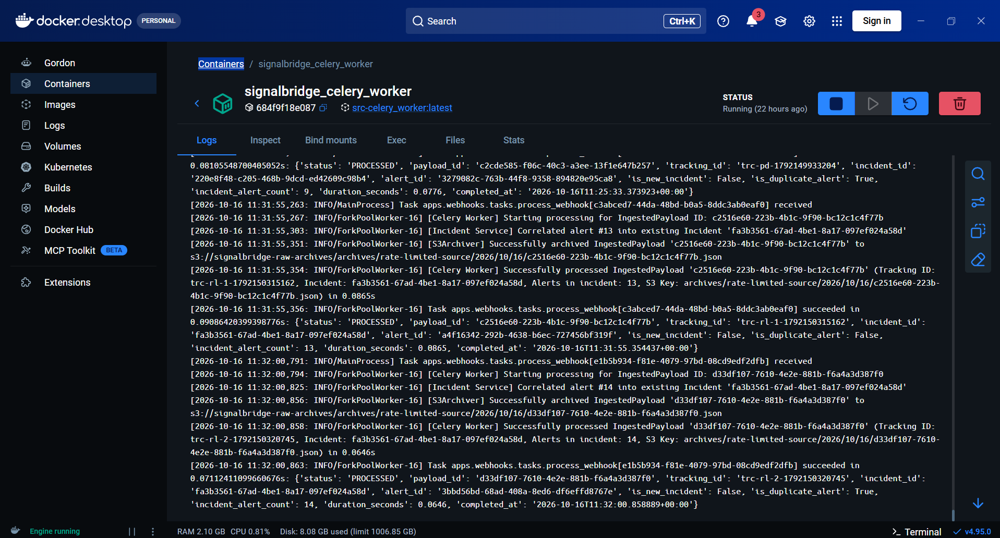
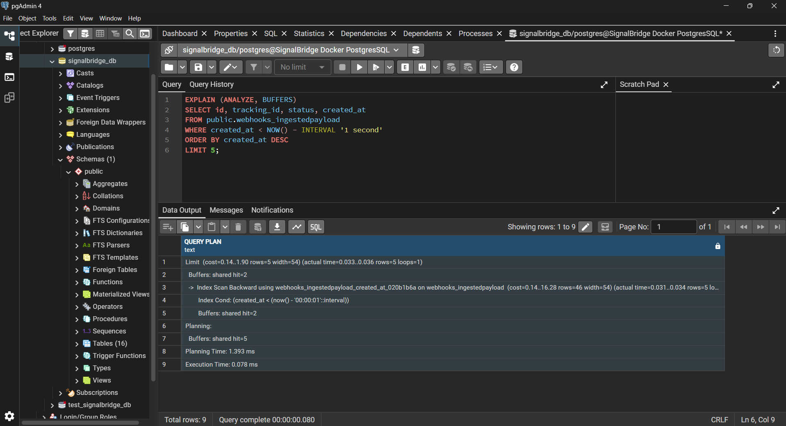

# SignalBridge — Secure Webhook Ingestion & Incident Correlation

[](https://www.python.org/)
[](https://www.django-rest-framework.org/)
[](https://www.postgresql.org/)
[](https://redis.io/)
[](https://docs.celeryq.dev/)
[](https://docs.docker.com/compose/)
[](https://www.npmjs.com/package/newman)

**SignalBridge is a backend engineering project that receives signed webhooks, validates and deduplicates deliveries, and processes alerts asynchronously to correlate related events into incidents.** It is built with Django REST Framework, PostgreSQL, Redis, Celery, and S3-compatible local object storage.

> **Project status:** Local development and verification project. The included Docker setup uses S3Mock, not a production AWS deployment. Performance figures from local runs are environment-specific and are not production SLAs.

## At a glance

- **Secure ingestion:** HMAC-SHA256 signature verification against the raw request body, using constant-time comparison.
- **Request idempotency:** Atomic Redis `SET NX` reservation with a 60-second TTL for repeat webhook deliveries.
- **Burst protection:** A rolling in-process sliding-window rate limiter with `429 Too Many Requests` and `Retry-After` information.
- **Asynchronous processing:** Celery workers handle alert normalization, incident correlation, and payload archiving outside the HTTP request.
- **Concurrency control:** PostgreSQL advisory locks and row-level locking protect incident creation and updates under concurrent processing.
- **Operational visibility:** Tracking IDs, structured task logging, health and API documentation routes, and local verification artifacts.

## Why I built it

Webhook receivers need to acknowledge requests promptly without doing every downstream operation in the request cycle. They also need to handle retry deliveries safely, reject requests with invalid signatures, control bursts, and avoid opening multiple incident records when related alerts arrive concurrently.

SignalBridge explores these backend problems in one reproducible local system. It separates **ingestion** from **processing**, uses different safeguards at the request and database layers, and includes automated checks for API behavior and concurrent incident creation.

## Architecture



### Request lifecycle

1. Receive `POST /api/v1/webhooks/<source_slug>/` with a JSON body and signature header.
2. Resolve the webhook source and check its `is_active` flag.
3. Validate the HMAC-SHA256 signature against the original request bytes.
4. Enforce the source's rolling-window rate limit.
5. Check the Redis idempotency key. A repeated request within the TTL returns `200 OK` with `duplicate_ignored`.
6. Persist a new payload as `PENDING`, enqueue `process_webhook`, and respond with `202 Accepted` and a tracking ID.
7. A Celery worker normalizes the alert, correlates it with an open incident, updates severity and incident metadata, and attempts to archive the raw payload.

## Engineering decisions worth exploring

| Area | Implementation | Why it matters |
|---|---|---|
| Webhook authenticity | HMAC-SHA256 over raw request bytes and `hmac.compare_digest()` | Authenticates the payload and avoids ordinary early-exit string comparison. |
| Request idempotency | SHA-256 payload fingerprint with Redis `SET NX` and a 60-second TTL | Prevents an identical webhook delivery from being persisted and queued again during the reservation window. |
| Rate limiting | `collections.deque`-based sliding window guarded by a thread lock | Demonstrates rolling-window eviction and per-source burst protection in a local single-process implementation. |
| Incident correlation | PostgreSQL transaction advisory lock plus `SELECT FOR UPDATE` | Serializes competing workers that may otherwise create multiple incidents for the same service and fingerprint. |
| Severity escalation | Normalize severity values and compare priority before updating an open incident | Lets a higher-priority alert raise the severity of an existing incident. |
| Async processing | Celery task with primitive payload ID, late acknowledgements, and retry configuration | Keeps downstream work out of the HTTP request handler and separates web and worker processes. |
| Payload archiving | Boto3 client targeting S3Mock locally | Exercises S3-compatible object storage without requiring an AWS account for local development. |
| API contract | OpenAPI schema and Swagger UI/ReDoc routes | Makes the endpoint contract discoverable and easier to inspect. |

## Tech stack

- **Language:** Python 3.11
- **API:** Django 5.1, Django REST Framework
- **Database:** PostgreSQL 16
- **Cache and task broker:** Redis 7
- **Background jobs:** Celery 5.4
- **Object storage interface:** Boto3 with Adobe S3Mock for local testing
- **Testing and quality:** pytest, pytest-django, pytest-cov, Newman/Postman
- **Local orchestration:** Docker, Docker Compose
- **CI:** GitHub Actions workflow at [`.github/workflows/ci.yml`](.github/workflows/ci.yml)

## Verification and evidence

The project includes unit, integration, and concurrency tests, plus a Postman collection for exercising the API through HTTP.

| Check | Reported result | Evidence / command |
|---|---|---|
| Pytest suite | **57 tests** in the latest run reported by the project owner | Run `docker compose exec web pytest -q` after starting the environment. |
| Coverage | **92% statement coverage** reported in a local run; rerun to refresh the number after code changes | `docker compose exec web pytest --cov=apps --cov-report=term-missing` |
| Newman API verification | **14 requests, 28 assertions, zero failures** in the recorded run | [`postman/SignalBridge_API_Verification.postman_collection.json`](postman/SignalBridge_API_Verification.postman_collection.json) |
| Concurrent incident creation | Test exercises **20 concurrent threads** and asserts a single incident is created for matching alerts | [`tests/concurrency/test_incident_locking.py`](tests/concurrency/test_incident_locking.py) |

The recorded Newman run reports local response-time measurements, but timings vary by machine and environment. The repository's current screenshots do not all show the same latency range, so **do not treat the historical figures as a guaranteed latency SLA**. Refresh the benchmark and its screenshots before making a performance claim.

### Screenshots

These screenshots illustrate selected local checks. They are demonstrations from a development environment, not proof of production deployment.

<details>
<summary>API health and documentation</summary>



</details>

<details>
<summary>Invalid HMAC signature rejected</summary>



</details>

<details>
<summary>Repeated webhook request detected</summary>



</details>

<details>
<summary>Rate limit exceeded</summary>



</details>

<details>
<summary>Celery background worker log</summary>



</details>

<details>
<summary>PostgreSQL query plan</summary>



</details>

## Run locally

### Prerequisites

- Docker Desktop with Docker Compose
- Git

### 1. Clone the repository

```bash
git clone https://github.com/Karthik-bhandarkar/signalbridge.git
cd signalbridge
```

### 2. Create the local environment file

**macOS / Linux / Git Bash:**

```bash
cp .env.example .env
```

**Windows PowerShell:**

```powershell
Copy-Item .env.example .env
```

The example file is for local development. Review its values before running the application. Never commit `.env` or real credentials.

### 3. Build and start the services

```bash
docker compose up -d --build
docker compose ps
```

The Compose configuration starts five services: PostgreSQL, Redis, S3Mock, the Django web service, and a Celery worker.

### 4. Apply database migrations

```bash
docker compose exec web python manage.py migrate
```

### 5. Run the tests

```bash
docker compose exec web pytest -q
```

For statement coverage:

```bash
docker compose exec web pytest --cov=apps --cov-report=term-missing
```

### 6. Open the local API

- Health endpoint: `http://localhost:8000/`
- OpenAPI schema: `http://localhost:8000/api/schema/`
- Swagger UI: `http://localhost:8000/api/docs/`
- ReDoc: `http://localhost:8000/api/redoc/`

### 7. Run the API verification collection

1. Start the Docker Compose environment and ensure the required webhook sources exist in the local database.
2. Import [`postman/SignalBridge_API_Verification.postman_collection.json`](postman/SignalBridge_API_Verification.postman_collection.json) into Postman.
3. Import [`postman/SignalBridge_Environment_Template.postman_environment.json`](postman/SignalBridge_Environment_Template.postman_environment.json) and select it.
4. Set `baseUrl`, source slugs, and `webhookSecret` to match your local configuration. The environment template intentionally uses a placeholder for the HMAC secret.
5. Run the collection and review the HTTP status and assertion results.

If Newman is installed, run the collection from the repository root:

```bash
newman run postman/SignalBridge_API_Verification.postman_collection.json \
  -e postman/SignalBridge_Environment_Template.postman_environment.json
```

## API overview

**Primary endpoint:** `POST /api/v1/webhooks/<source_slug>/`

Required headers:

```http
Content-Type: application/json
X-Signature-256: sha256=<hex_digest>
```

Example request body:

```json
{
  "event_type": "alert.trigger",
  "tracking_id": "trc-example-1001",
  "payload": {
    "service": "payment-api",
    "severity": "CRITICAL",
    "fingerprint": "database-timeout",
    "title": "Database connection pool exhausted",
    "description": "API latency exceeded 5000ms"
  }
}
```

| HTTP status | Meaning |
|---|---|
| `202 Accepted` | Valid, new webhook persisted and queued for asynchronous processing. |
| `200 OK` | Identical webhook request recognized within the idempotency TTL. |
| `400 Bad Request` | Invalid request envelope. |
| `401 Unauthorized` | Missing or invalid HMAC signature. |
| `403 Forbidden` | Webhook source exists but is inactive. |
| `404 Not Found` | Source slug is not registered. |
| `429 Too Many Requests` | Source rate limit exceeded; response includes a retry hint. |

## Known limitations and next steps

SignalBridge is a local engineering project and has not been presented as a production deployment. Before using it for real traffic, the following areas need additional hardening:

- **Distributed rate limiting:** the current sliding-window limiter keeps state in process memory. Multiple web replicas would each maintain a separate counter; a shared Redis-backed limiter would be needed for a cluster-wide limit.
- **Ingestion consistency:** the Redis idempotency reservation is acquired before payload persistence and task enqueueing. A crash in that interval can suppress a retry even though durable ingestion did not finish. A transactional outbox or carefully designed reservation/rollback flow would strengthen this boundary.
- **Archive failure semantics:** the worker should not report a payload as successfully processed when archival fails or returns no storage key. Error propagation, retry behavior, and processing status transitions should be hardened and covered by tests before production use.
- **Load and latency benchmarks:** run repeatable measurements with documented concurrency, warm-up, sample count, and environment. Do not infer production throughput from individual local requests.
- **Production deployment:** real AWS S3 credentials, IAM policies, secure Django settings, secret management, logging/monitoring, and deployment configuration are not supplied by the local S3Mock-based setup.

## Repository layout

```text
apps/
  alerts/       # Alert and incident models, correlation, incident services
  analytics/    # Analytics and metrics models
  core/dsa/     # Idempotency, sliding-window rate limiting, retry min-heap
  webhooks/     # Ingestion API, signatures, Celery tasks, S3 archiving
config/         # Django settings, URL configuration, Celery setup
requirements/   # Base, local, and test dependencies
tests/
  unit/         # Unit tests for core utilities
  integration/  # API, worker lifecycle, docs/admin checks
  concurrency/  # Concurrent incident-creation test
postman/        # API collection and sanitized environment template
evidence/       # Verification screenshots, evidence index, data export
schema.yml      # OpenAPI schema
Dockerfile
docker-compose.yml
pytest.ini
```

## Author

**Karthik Bhandarkar**

- GitHub: [@Karthik-bhandarkar](https://github.com/Karthik-bhandarkar)
- Project repository: [SignalBridge](https://github.com/Karthik-bhandarkar/signalbridge)

---

*Note: This README describes the current local implementation and its reported test evidence. Re-run the test suite and refresh any performance screenshots after code changes so the public documentation stays aligned with the repository.*
