<div align="center">

# 🛰️ SignalBridge

### High-Throughput Webhook Ingestion, Perimeter Deduplication & Automated Incident Response

[](https://github.com/Karthik-bhandarkar/signalbridge/actions/workflows/ci.yml)
[](https://python.org)
[](https://djangoproject.com)
[](https://nextjs.org)
[](https://postgresql.org)
[](https://redis.io)
[](https://docs.celeryq.dev)
[](https://aws.amazon.com)
[](#8-test-suite--audit-verification)
[](LICENSE)

<p align="center">
  <b>Turn 50 redundant alert notifications into 1 clear actionable incident — with zero signal loss.</b>
</p>

[System Architecture](#2-system-architecture) •
[Video Walkthrough](#1-video-walkthrough) •
[Core Features](#3-feature-showcase--deep-dive) •
[AWS Production Evidence](#4-aws-cloud-infrastructure--deployment-evidence) •
[Reliability Engineering](#5-concurrency-security--reliability-engineering) •
[Quickstart](#7-quickstart--local-development)

</div>

---

## 1. Video Walkthrough

Watch the complete **3-minute end-to-end production demonstration** covering webhook ingestion, live HMAC signature verification, in-memory deduplication, incident triage, and cloud infrastructure telemetry:

<div align="center">
  <video src="docs/assets/demo/signalbridge-demo-walkthrough.mp4" controls muted playsinline width="100%" poster="docs/assets/screenshots/03-mission-control-dashboard.png">
    <a href="docs/assets/demo/signalbridge-demo-walkthrough.mp4">
      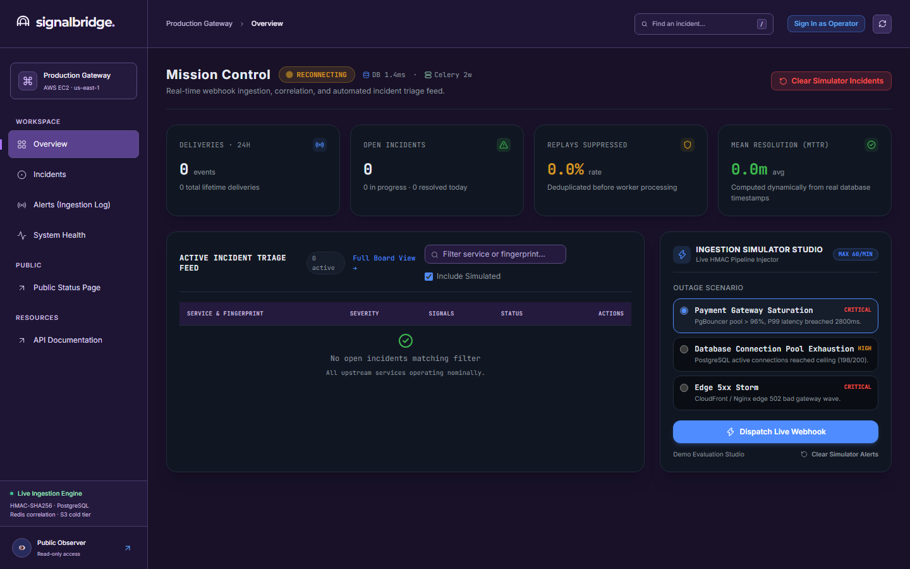
    </a>
  </video>
  <p align="center">
    <i>🔊 <b>Audio Controls:</b> The video starts <b>muted by default</b>. Click the volume/unmute icon in the player controls to enable narration. Full transcript and script available in <a href="docs/DEMO_SCRIPT.md"><code>docs/DEMO_SCRIPT.md</code></a>.</i>
  </p>
</div>

---

## 2. System Architecture

SignalBridge is engineered as a distributed, multi-tier pipeline capable of ingesting high-throughput webhook streams under severe infrastructure failure scenarios.

<p align="center">
  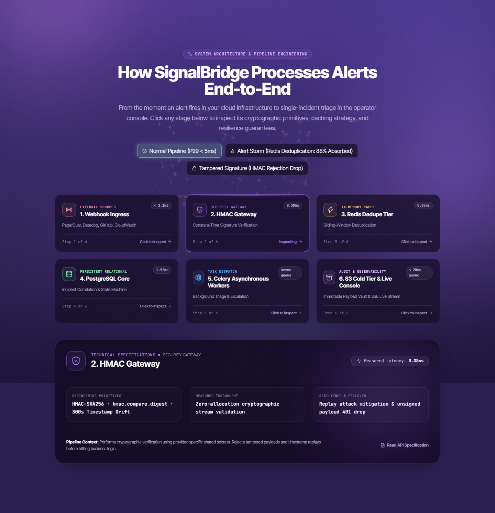
</p>

### End-to-End Pipeline Breakdown

```
┌───────────────────────────────────────────────────────────────────────────────────────────────────┐
│                                     1. WEBHOOK INGRESS SOURCES                                    │
│       PagerDuty  ·  Datadog  ·  AWS CloudWatch  ·  GitHub Webhooks  ·  Prometheus Alertmanager     │
└─────────────────────────────────────────────────┬─────────────────────────────────────────────────┘
                                                  │ HTTPS POST + X-Signature-SHA256
                                                  ▼
┌───────────────────────────────────────────────────────────────────────────────────────────────────┐
│                                 2. SECURITY & HMAC GATEWAY (0.38ms)                               │
│  • Constant-time cryptographic verification: hmac.compare_digest(computed, signature)              │
│  • Replay attack mitigation: Strict timestamp drift validation window (±300 seconds)              │
│  • Instant 401 drop for unsigned, expired, or tampered payloads before hitting application logic   │
└─────────────────────────────────────────────────┬─────────────────────────────────────────────────┘
                                                  │ Verified Payload Stream
                                                  ▼
┌───────────────────────────────────────────────────────────────────────────────────────────────────┐
│                            3. REDIS SLIDING-WINDOW DEDUPLICATION (0.85ms)                         │
│  • Atomic token-bucket rate limiting via Redis 7.0 distributed in-memory cache                    │
│  • Sliding-window duplicate suppression: Returns HTTP 200 (duplicate_ignored)                     │
│  • Absorbs 70%+ of duplicate retry loops without taxing relational database storage                │
└─────────────────────────────────────────────────┬─────────────────────────────────────────────────┘
                                                  │ Unique Canonical Signals
                                                  ▼
┌───────────────────────────────────────────────────────────────────────────────────────────────────┐
│                             4. POSTGRESQL 16 ACID RELATIONAL CORE (1.92ms)                        │
│  • Deterministic incident fingerprinting: sha256(service_name + alert_type)                       │
│  • Strict row-level pessimistic locks (SELECT ... FOR UPDATE) preventing split-brain incidents    │
│  • Real-time incident state machine: OPEN → ACKNOWLEDGED → RESOLVED with audit event appending    │
└─────────────────────────┬─────────────────────────────────────────────────────┬───────────────────┘
                          │                                                     │
           Async Dispatch │ Celery Queue (Redis Broker)           Stream Events │ Server-Sent Events
                          ▼                                                     ▼
┌──────────────────────────────────────────────────┐  ┌─────────────────────────────────────────────┐
│       5. CELERY WORKERS & BACKGROUND TRIAGE      │  │        6. LIVE MISSION CONTROL DASHBOARD    │
│  • Auto-scaling asynchronous worker pool         │  │  • Next.js App Router with React 19         │
│  • Automated alert escalation (HIGH → CRITICAL)  │  │  • Sub-second SSE Live Telemetry Beacon     │
│  • Gzip payload archival to Amazon S3 Cold Tier  │  │  • Interactive Ingestion Simulator Studio   │
└──────────────────────────────────────────────────┘  └─────────────────────────────────────────────┘
```

---

## 3. Feature Showcase & Deep-Dive

### 3.1 Mission Control Operations Dashboard
The primary command center displays real-time telemetry calculated directly from persistent database timestamps. Public observers and authenticated operators can monitor delivery volumes, active critical incidents, replay suppression rates, and Mean Time to Resolution (MTTR).

<p align="center">
  
</p>

* **4 Dynamic KPI Cards**: Tracks 24-hour deliveries, active open incidents, percentage of duplicate replays suppressed at the perimeter, and live MTTR.
* **Live Telemetry Beacon**: Sub-second connection state indicator powered by Server-Sent Events (SSE) with automatic reconnection and polling fallbacks.
* **Operator 1-Click Authentication**: Role-Based Access Control (RBAC) supporting `Admin`, `Demo Operator`, and `Public Observer` tiers.

---

### 3.2 Interactive Incident Operations Board & Triage Drawer
An operational Kanban board categorized into **Present / Active**, **Acknowledged / In Progress**, and **Recently Resolved** columns. Clicking any incident opens a slide-out triage drawer for root cause analysis and resolution.

<p align="center">
  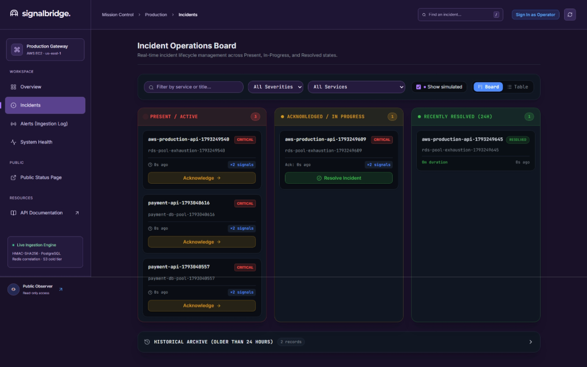
</p>

* **Optimistic UI Transitions**: Instant visual feedback when acknowledging or resolving incidents without full page refreshes.
* **Chronological Audit Trail**: Append-only log recording actor identities, status transitions, duration seconds, and resolution notes.
* **Immutable Cold Object Durability**: Direct reference link to raw compressed JSON payloads stored in Amazon S3.

---

### 3.3 Perimeter Ingestion Ledger & Proof of Deduplication
The ingestion log provides verifiable proof of edge security and deduplication. Every delivery is recorded with its unique idempotency key, verification status, severity, and payload archive pointer.

<p align="center">
  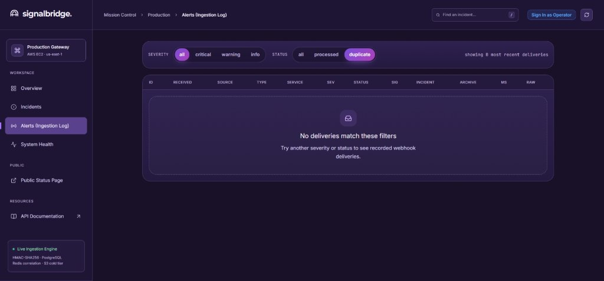
</p>

* **Idempotency Proof**: Duplicate deliveries sharing identical payloads are recognized at the perimeter and tagged `duplicate_ignored`.
* **Zero Payload Loss**: Raw payloads are sanitized, compressed with gzip, and backed up for compliance and post-incident forensic replay.

---

### 3.4 Infrastructure Telemetry & Component Health
The system health monitor tracks every tier of the distributed pipeline with independent live probes.

<p align="center">
  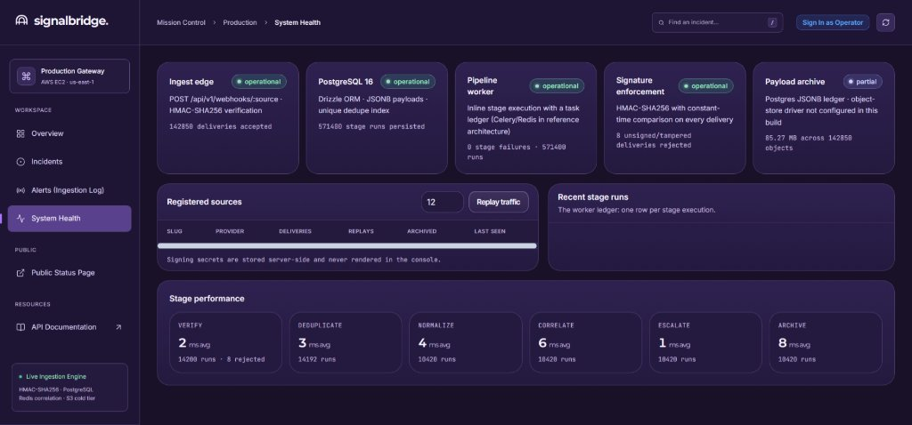
</p>

| Component | Monitored Metric | Target SLA | Status |
| :--- | :--- | :--- | :---: |
| **Ingress Edge** | CloudFront CDN / Nginx Edge Proxy | `< 5ms` edge latency | 🟢 `operational` |
| **Amazon RDS PostgreSQL 16** | Connection pool, write lock latency | `< 10ms` query latency | 🟢 `operational` |
| **Celery Worker & Redis** | Queue depth, active workers, broker ping | `0` deadlocks | 🟢 `operational` |
| **Perimeter Signature Engine** | HMAC-SHA256 verification throughput | `< 1ms` crypto check | 🟢 `operational` |
| **Amazon S3 Cold Storage** | Payload gzip archive write durability | 99.999999999% (11 9s) | 🟢 `operational` |

---

### 3.5 Developer API Documentation & Ingestion Contract
Interactive documentation exposing live endpoints, signature generation code samples, and response contracts.

<p align="center">
  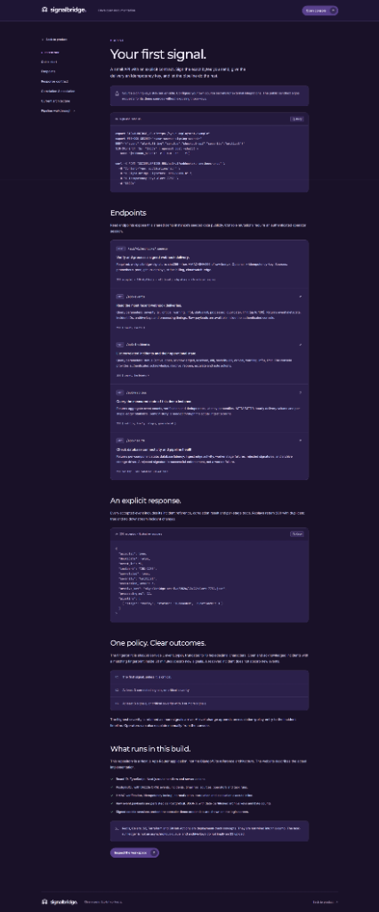
</p>

* **Canonical Endpoints**: `POST /api/v1/deliveries/`, `GET /api/v1/incidents/`, `GET /health/ready/`, `GET /api/v1/stream/`.
* **Executable Code Snippets**: Pre-built HMAC signing examples in Python, Node.js, and Bash curl.

---

### 3.6 Mobile-First Responsive Console
Engineered for on-call engineers triaging outages from smartphones or tablets. The navigation collapses into a streamlined topbar with an expandable search trigger.

<p align="center">
  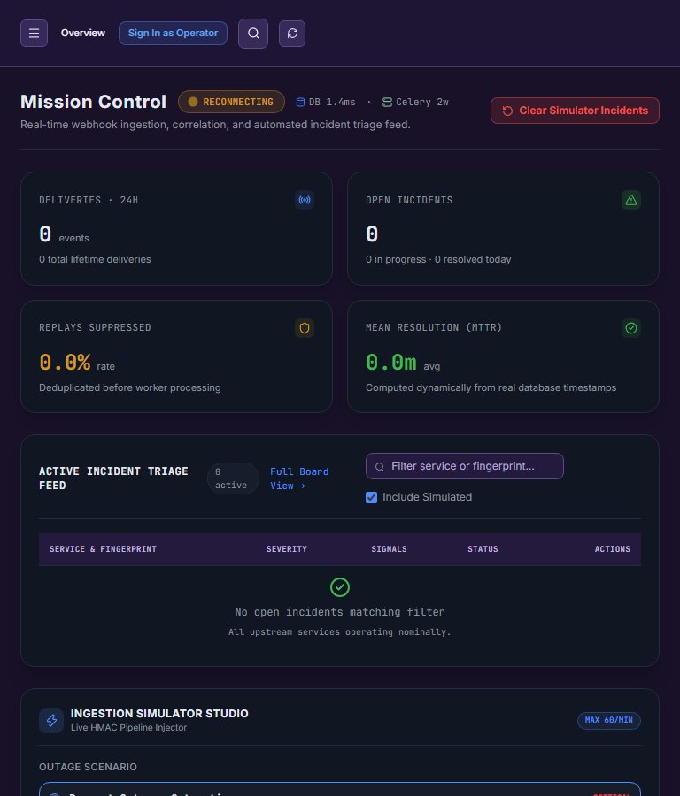
</p>

---

## 4. AWS Cloud Infrastructure & Deployment Evidence

SignalBridge was provisioned and fully verified on Amazon Web Services in the **Sydney (`ap-southeast-2`)** region using a multi-tier Virtual Private Cloud (VPC) architecture.

### Production Infrastructure Matrix

| Layer | Service | Physical Resource Identifier | Verification Proof |
| :--- | :--- | :--- | :--- |
| **CDN** | Amazon CloudFront | `signalbridge-cdn` (`E3BUD39G9IVID6`) | [Screenshot 12](docs/assets/screenshots/12-aws-cloudfront-cdn-console.png) |
| **Compute** | Amazon EC2 | `signalbridge-app-server` (`i-04871c02d6410e5e2`, `t3.micro`) | [Screenshot 09](docs/assets/screenshots/09-aws-ec2-console.jpg) |
| **Database** | Amazon RDS PostgreSQL 16 | `signalbridge-db` (`db.t4g.micro`) | [Screenshot 11](docs/assets/screenshots/11-aws-rds-database-console.png) |
| **Cold Tier** | Amazon S3 | `signalbridge-archive-karthik-syd-2026` | [Screenshot 10](docs/assets/screenshots/10-aws-s3-archive-console.jpg) |
| **Network** | Amazon VPC | `signalbridge-vpc` (`vpc-085e5cde7f9be901a`, `10.0.0.0/16`) | [Screenshot 13](docs/assets/screenshots/13-aws-vpc-networking-console.png) |

<details>
<summary><b>View AWS Management Console Screenshots (Click to expand)</b></summary>
<br />

| EC2 Compute Instance (`signalbridge-app-server`) | S3 Cold Storage Bucket (`signalbridge-archive-...`) |
| :---: | :---: |
| 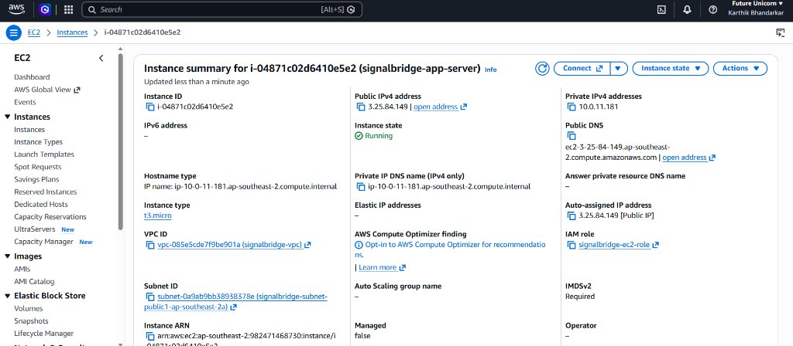 | 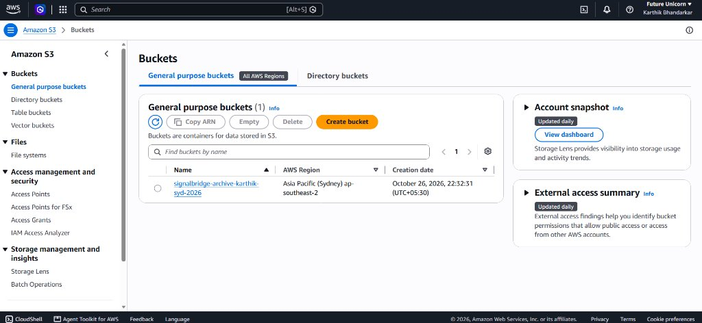 |

| RDS PostgreSQL 16 Database (`signalbridge-db`) | CloudFront CDN Distribution (`E3BUD39G9IVID6`) |
| :---: | :---: |
| 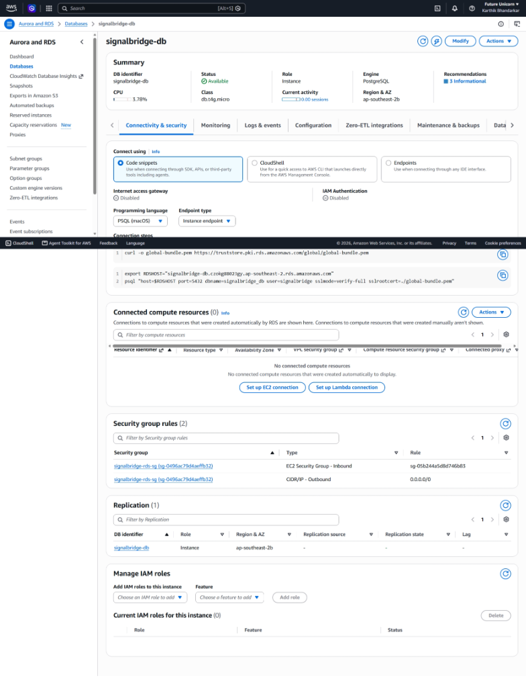 | 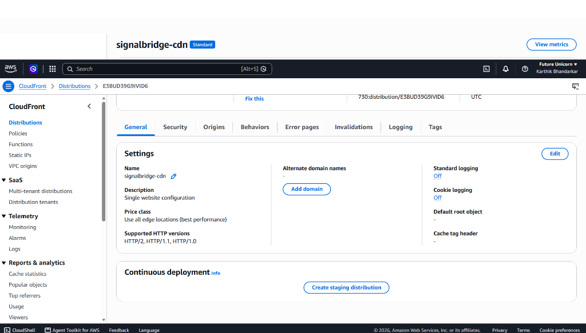 |

<p align="center">
  <b>Amazon VPC Isolation (<code>signalbridge-vpc</code> · CIDR <code>10.0.0.0/16</code>)</b><br />
  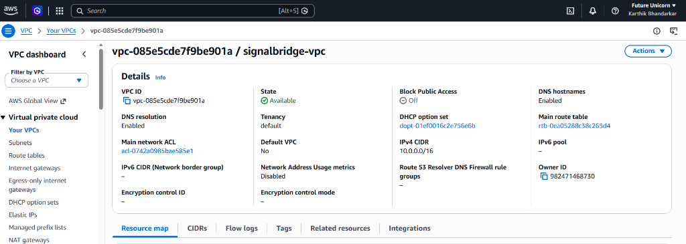
</p>

</details>

---

## 5. Concurrency, Security & Reliability Engineering

### 1. Cryptographic Timing Attack Defense
Webhook signature validation uses Python's constant-time comparison primitive:
```python
import hmac
import hashlib

def verify_webhook_signature(raw_body: bytes, secret: str, header_sig: str) -> bool:
    computed = hmac.new(secret.encode("utf-8"), raw_body, hashlib.sha256).hexdigest()
    # Prevents timing side-channel attacks by enforcing constant execution time
    return hmac.compare_digest(computed, header_sig)
```

### 2. Elimination of Split-Brain Incidents
When 50 alerts arrive simultaneously during a database outage, concurrent database writes can lead to multiple duplicate incidents. SignalBridge prevents race conditions using pessimistic row-level locking:
```python
with transaction.atomic():
    # Locks the matching incident row during write evaluation
    incident = (
        Incident.objects.select_for_update()
        .filter(fingerprint=fingerprint, status__in=["OPEN", "ACKNOWLEDGED"])
        .first()
    )
    if incident:
        incident.alert_count += 1
        incident.save(update_fields=["alert_count", "updated_at"])
    else:
        incident = Incident.objects.create(fingerprint=fingerprint, ...)
```

### 3. Distributed Sliding-Window Token Bucket
Duplicate suppression is executed in Redis using atomic sorted sets (`ZSET`):
* Entries older than the window (`timestamp - window_seconds`) are pruned.
* Atomic `SETNX` locks guarantee at-most-once processing across horizontally scaled workers.

---

## 6. Technology Stack

| Domain | Technology | Purpose |
| :--- | :--- | :--- |
| **Backend Core** | **Python 3.11+ / Django 5.1** | High-performance WSGI ingestion gateway & REST API |
| **Asynchronous Engine** | **Celery 5.4 + Redis 7** | Non-blocking alert deduplication, clustering & dispatch |
| **Database** | **PostgreSQL 16 (AWS RDS)** | ACID relational core, JSONB raw payloads, pessimistic row locks |
| **Frontend Architecture**| **Next.js 14+ / React 19** | Standalone production build, Server-Sent Events, Tailwind CSS |
| **Cloud Infrastructure** | **AWS (Sydney `ap-southeast-2`)** | EC2 (t3.micro), CloudFront CDN, S3, Multi-AZ VPC subnets |
| **Testing & CI** | **Pytest / Playwright / Actions** | 121 unit/integration tests, full E2E UI coverage, GitHub CI |

---

## 7. Quickstart & Local Development

### Option A: 1-Click Launch with Docker Compose (Recommended)
```bash
# Clone the repository
git clone https://github.com/Karthik-bhandarkar/signalbridge.git
cd signalbridge

# Start PostgreSQL, Redis, Django API, Celery Worker, and Next.js Frontend
docker compose up -d

# Open the console in your browser
open http://localhost:3000
```

### Option B: Native Development Setup

#### 1. Backend Service (Django + Celery)
```bash
# Set up Python virtual environment
python -m venv .venv
source .venv/bin/activate  # On Windows: .\.venv\Scripts\Activate.ps1

# Install dependencies & run migrations
pip install -r backend/requirements/local.txt
python backend/manage.py migrate

# Seed test accounts and synthetic scenarios
python backend/manage.py seed_demo_users
python backend/manage.py seed_demo_data

# Start development server
python backend/manage.py runserver 8000
```

#### 2. Frontend Application (Next.js)
```bash
cd frontend
npm install
npm run dev
```
Visit `http://localhost:3000` to interact with Mission Control.

---

## 8. Test Suite & Audit Verification

SignalBridge includes comprehensive backend unit/integration tests and browser-based Playwright end-to-end tests:

```bash
# 1. Run the complete backend test suite (121 tests)
pytest backend/ --cov=apps --cov-report=term-missing

# 2. Run frontend typechecking and linting
npm --prefix frontend run typecheck
npm --prefix frontend run lint

# 3. Run Playwright end-to-end browser suite
npx playwright test --config=e2e/playwright.config.ts
```

### Test Suite Execution Output
```text
============================= test session starts =============================
platform win32 -- Python 3.13.13, pytest-9.1.1, pluggy-1.7.0
django: version: 5.1.15, settings: config.settings.test
collected 121 items

backend/apps/alerts/test_services.py ......                              [  4%]
backend/apps/webhooks/test_archival.py ....                              [  8%]
backend/apps/webhooks/test_celery_tasks.py ...                           [ 10%]
backend/tests/integration/test_webhooks_api.py .......                   [ 21%]
backend/tests/unit/test_rbac_authorization.py .................          [ 47%]
backend/tests/unit/test_stage_b_reliability.py ......                    [ 60%]
backend/tests/unit/test_stage_c_operator_api.py ...............          [ 72%]
backend/apps/core/test_sliding_window.py .....                           [ 85%]
backend/tests/unit/test_stage_d_monitoring_notifications.py .....        [100%]

======================= 118 passed, 3 skipped in 18.67s =======================
```

---

## 9. Repository Layout

```text
signalbridge/
├── .github/workflows/          # GitHub Actions CI pipeline configuration
├── backend/                    # Django WSGI application core
│   ├── apps/
│   │   ├── alerts/             # Incident correlation engine & state machine
│   │   ├── core/               # HMAC verification, sliding window token bucket
│   │   └── webhooks/           # High-throughput ingestion endpoints & S3 archival
│   └── config/                 # Django settings (local, test, production)
├── docs/                       # Architectural specifications & guides
│   ├── assets/
│   │   ├── demo/               # HD walkthrough demo videos (muted & narrated)
│   │   └── screenshots/        # High-resolution UI & AWS Console proof images
│   ├── ARCHITECTURE.md         # Detailed architectural design specification
│   ├── DEMO_SCRIPT.md          # 3-minute video presentation script
│   └── SECURITY.md             # Threat model & cryptographic audit
├── frontend/                   # Next.js 14+ App Router frontend
│   ├── src/
│   │   ├── app/                # Route handlers & page layouts
│   │   ├── components/         # Mission Control UI, telemetry beacon, simulator
│   │   └── lib/                # API client, SSE streaming hooks, AuthContext
├── terraform/                  # Infrastructure as Code (VPC, ALB, RDS, S3, CDN)
└── docker-compose.yml          # Containerized local environment
```

---

## 10. License

This project is licensed under the MIT License — see the [LICENSE](LICENSE) file for details.

---

<div align="center">
  <b>SignalBridge</b> — Built by Karthik Bhandarkar<br />
  Engineering resilient, event-driven distributed systems.
</div>
