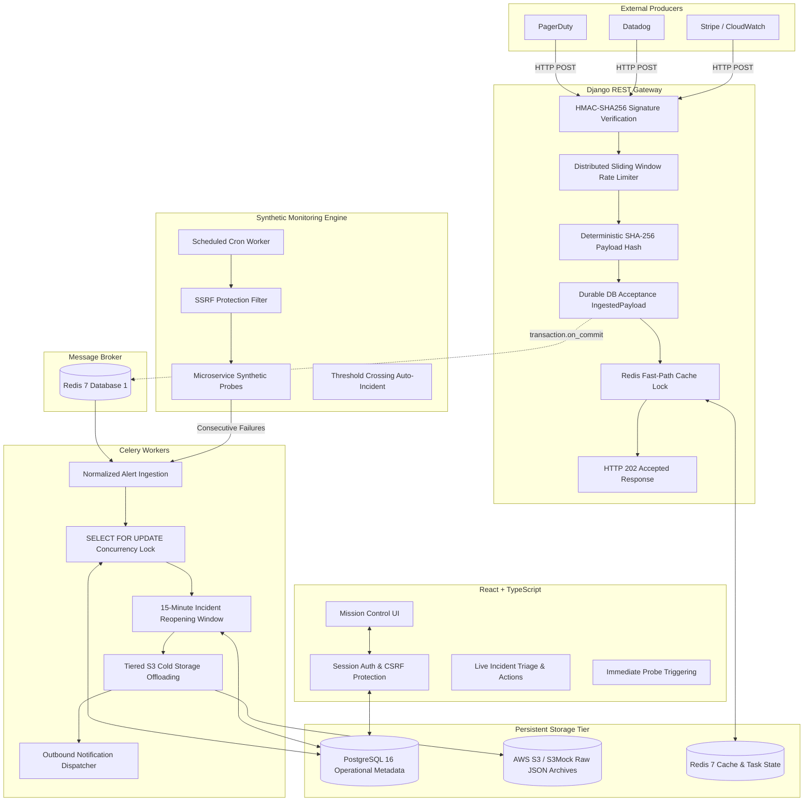

# 🏛️ SignalBridge Architecture & System Design

SignalBridge is an enterprise-grade, high-throughput asynchronous webhook ingestion and operational incident correlation platform built in Python (Django REST Framework, Celery, PostgreSQL 16, Redis 7, and AWS S3) with a mission-control React & TypeScript operator dashboard.

---

## 1. High-Level Architectural Flow

---

## 2. Key Architectural Decisions

### 2.1 The Sub-100ms Asynchronous ACK Pattern (RFC 9110)
External alert producers (PagerDuty, Datadog) enforce strict HTTP timeout windows (typically 2 to 5 seconds). Attempting synchronous database joins, alert grouping transactions, and S3 cold storage uploads in the request/response thread risks timeout failures and cascade re-delivery storms.

SignalBridge splits the ingestion pipeline into two distinct phases:
1. **Synchronous Gateway Perimeter (< 25–50ms):**
   - Webhook source resolution & active kill-switch check.
   - Constant-time HMAC-SHA256 cryptographic signature validation.
   - Distributed sliding window burst rate limiting (Redis ZSET atomic pipeline).
   - Database-first transactional persistence of `IngestedPayload` with `PENDING` status.
   - Redis fast-path caching.
   - Immediate **HTTP 202 Accepted** acknowledgement.
2. **Asynchronous Background Worker Fleet (Celery):**
   - Dispatched safely strictly upon database transaction commit (`transaction.on_commit`).
   - Alert normalization and severity hierarchy mapping.
   - High-concurrency incident correlation with PostgreSQL row locks.
   - Tiered S3 cold storage offloading.
   - Outbound notification dispatch.

### 2.2 Dual-Layer Idempotency & Concurrency Safety
In distributed systems, networks fail, workers crash, and webhooks re-deliver. SignalBridge enforces two layers of idempotency:
- **Perimeter Idempotency (Database-First):**
  A unique constraint `unique_payload_source_idempotency` on `(source, idempotency_hash)` in PostgreSQL guarantees that duplicates return HTTP 200 `duplicate_ignored` without creating redundant rows or queueing redundant Celery tasks.
- **Worker Redelivery Idempotency:**
  If Celery re-delivers a message (e.g. after worker container restart), `process_webhook` checks `payload_record.status == PROCESSED` and exits immediately with `ALREADY_PROCESSED`, ensuring incident `alert_count` and timeline events are never corrupted.

### 2.3 Row-Level Locking & Incident Grouping
When 20 parallel threads fire alerts for the same service and fingerprint at the exact same millisecond:
- In PostgreSQL, workers acquire transaction advisory locks `SELECT pg_advisory_xact_lock(hashtext(...))` and row-level locks `SELECT FOR UPDATE`.
- Exactly one `Incident` record is created; remaining 19 threads correlate their `Alert`s to the single parent incident, incrementing `alert_count` safely and escalating severity if a higher tier is observed.

### 2.4 Tiered Cold Storage Archiving
Storing multi-kilobyte raw JSON envelopes in PostgreSQL causes table bloat, exhausts RAM cache buffers, and slows B-tree index scans.
- **PostgreSQL 16:** Stores lean, structured metadata (UUIDs, timestamps, fingerprints, foreign keys, status).
- **AWS S3 / S3Mock:** Stores unmodified raw JSON payloads organized under date-partitioned hierarchical keys:
  `archives/{source_slug}/{YYYY}/{MM}/{DD}/{payload_id}.json`.
- Archival status is tracked truthfully (`NOT_STARTED`, `PENDING`, `ARCHIVED`, `FAILED`).

### 2.5 Active Synthetic Monitoring & SSRF Protection
SignalBridge incorporates an active outbound synthetic monitoring engine:
- Periodic probes check upstream microservices.
- **SSRF Protection:** Outbound probes are strictly validated against loopback (127.0.0.1, ::1), cloud metadata (169.254.169.254), and private RFC 1918 subnets, defending against internal network reconnaissance.
- If consecutive probe failures breach `failure_threshold`, an operational incident is automatically created in the alert correlation engine.
